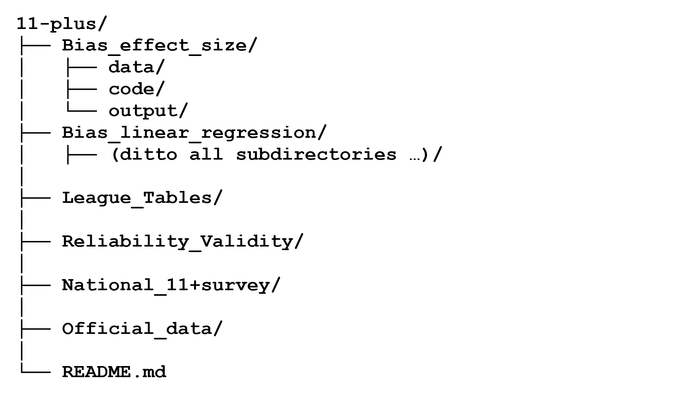

# High Stakes Academic Selection in England. 

This repository contains the data and programs underpinning research into the academic selection tests still used by some schools in England to determine which pupils they will admit. The test is commonly called the “11-plus” test because it determines children’s education from that age onwards. Data relating to this plus test is exceedingly difficult to obtain for independent research but the authors have been very persistent.

The 11-plus repository covers several studies. Each is organised under its own branch containing the relevant data, code and output. The overall structure looks like this:

.

Programs are written in Python and will run under any text-based installation with the relevant libraries installed. Scripts read their input data directly from the repository but if running locally will require an ./output directory to write to.

The output directory contains copies of all the output including material not in the paper. Data is normally output as a CSV file but includes a few Excel workbooks. Graphs are normally created as png files. Output file names reference the code that created them which in turn references the data used. Any artefact in the output directory can be traced back to the data and code used to create it. A README file associated with each study contains a description of the data, its analysis, and the results. Openly publishing the data and code this way means the methods can be independently scrutinised and others are able to adapt and build on the work done.

### Brief description of each study

| **Study** | **Description** |
| --- | --- |
| [Bias_effect_size](https://github.com/education-research/11-plus/tree/main/Bias_effect_size) | Data acquired for this research has enabled the effect sizes of candidates’ relative age and socio-economic status to be compared for the first time. Existing research on coaching has been used to work out the effect size enabling all three ‘interventions’ to be compared. |
| [Bias_linear_regression](https://github.com/education-research/11-plus/tree/main/Bias_linear_regression) | This uses additional rare and difficult to source data with linear regression to quantify the impact of age and SES on final scores. (The linear regression doesn’t cover coaching because no suitable data exists.) |
| [League_Tables](https://github.com/education-research/11-plus/tree/main/League_Tables)    | This section compares the “league tables” published by the Times Newspaper which describes itself as the definitive source of information on school performance but is based on raw exam results. Official data shows that over 90% of final results can be explained by prior intake. |
| [Reliability_Validity](https://github.com/education-research/11-plus/tree/main/Reliability_Validity) |Calculates the reliability confidence interval of the test. Illustrates the classification accuracy of the test from the individual candidates’ perspective. (About 10% of candidates are incorrectly told they “fail” the test.)  |
| [National_11+survey](https://github.com/education-research/11-plus/tree/main/National_11+survey) | There is no official record of this test. We believe ours is the first national survey on the impact of this test. 123,601 11-plus tests were taken in 2024 at a cost of £3.2million, excluding administration which we estimate doubles the true cost. |
| [Official_Data](https://github.com/education-research/11-plus/tree/main/Official_Data) | This section demonstrates how some of the longitudinal findings were derived from official government data. This information is in the public domain but not always easy to locate. |

The paper is currently under peer review. Anonymous contact can be made via [Discussions](https://github.com/education-research/11-plus/discussions/1.)
